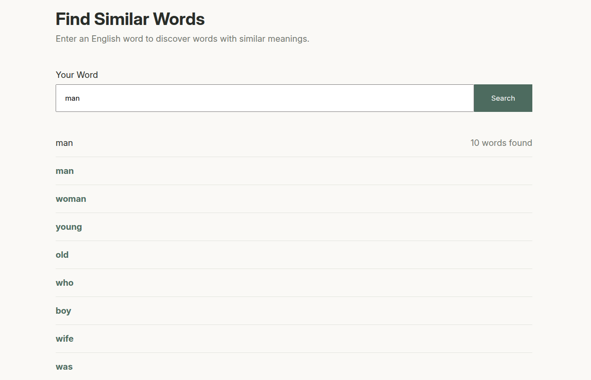

## Word Embeddings

Trained word embedding models with PyTorch. A word2vec model was trained on the text8 dataset and a GloVe model was trained on the brown corpus included with nltk. There is also a small flask web app that uses the trained GloVe embeddings to find similar words using cosine similarity.

